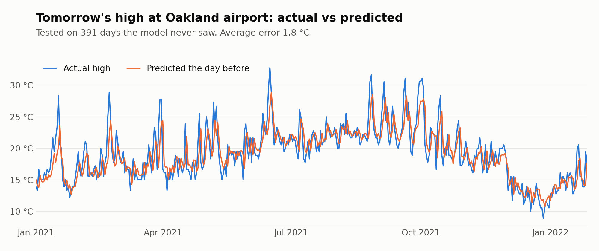

# Weather Prediction

**Can past weather predict tomorrow's high?** Within **1.8 °C** on average, using one station's daily
records and a simple Ridge regression.

<picture>
  <source media="(prefers-color-scheme: dark)" srcset="images/predictions-dark.png">
  
</picture>

## The data

NOAA daily records from **Oakland International Airport, California**, from 1960 to January 2022
(`local_weather.csv`). The records are in °F, so I convert the errors to °C. Some years are missing (1981–82 and most of 1987–1999), which leaves about
46 years of days. I kept precipitation and the daily maximum and minimum temperatures. Snow columns
were dropped (only one day on record had any snow), missing rain was filled with 0, and missing temperatures
with the day before.

## The approach

- **Target:** tomorrow's maximum temperature.
- **Model:** Ridge regression (scikit-learn, `alpha=0.1`).
- **Fair test:** trained on everything up to the end of 2020, tested on 2021 to January 2022
  (391 days). With time series the model must never see the future.

## Results

Mean absolute error on tomorrow's high, on the 391 test days:

| Model | Error |
|---|---|
| Guess "tomorrow = today" | 2.03 °C |
| Ridge, 3 core values (rain, high, low) | 1.90 °C |
| + 30-day rolling mean and ratios | 1.87 °C |
| + monthly and day-of-year averages (all 8) | 1.84 °C |
| 3 core values + monthly and day-of-year averages | **1.84 °C** |

Today's high does most of the work. The averages help a little by pulling predictions towards what's
normal for the time of year. The biggest misses are sudden heat spikes, which no model built only
from yesterday's numbers can see coming.

## Run it

```bash
pip install pandas scikit-learn matplotlib jupyter
jupyter notebook weather.ipynb
```

## Next steps

- Predict the whole next week, not just tomorrow.
- Combine several nearby stations, then try London.
- Backtest across every year, not just 2021.
- Try other algorithms, such as gradient boosting.
